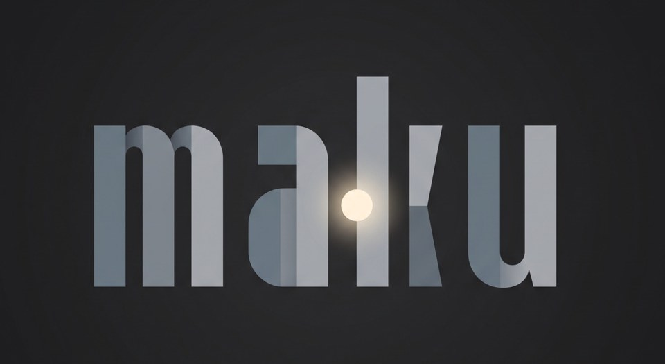

# MAKU

**MAKU (幕間機)** is an always-on ambience machine for the M-VAVE FM-1: power it on and a new, random, in-key
world is already playing. Four parts (a pulse, a floor, a haze, a voice), four volume knobs, three macros per part,
and buttons that are verbs (sink, cascade, swell, wobble, lift, scramble, drift). Nothing is saved but your likes:
every boot is a new world, HOME held makes another, and REC marks one you like; the more you like, the more the new
worlds come from your likes (a little changed), so MAKU grows to your taste.

MAKU is built on [Felucca](https://github.com/hugelton/Felucca) by Leo Kuroshita (Hügelton Instruments), GPL-3.0-only.
The sequencer editing, presets and projects, engine pages, web editor and the other Felucca features are removed (see
[docs/AMBIENT.md](docs/AMBIENT.md), "捨てるもの"). Installing is at your own risk: M-VAVE's updater or the installer's
**Return to official V15** takes you back. Not yet verified on hardware.

**Try it in your browser: [MAKU emulator](https://okumurari2.github.io/maku/)** (GitHub Pages, built from `web/emu/`).

## Docs

- [docs/SPEC.md](docs/SPEC.md): **start here**, the current spec in one self-contained page (English), and a map of the docs
- [docs/AMBIENT.md](docs/AMBIENT.md): the spec (Japanese)
- [docs/MAKU.md](docs/MAKU.md): design notes of the generator under it (Japanese)
- [docs/VOICES_RATING.md](docs/VOICES_RATING.md): the voice catalog and how it is rated (Japanese)
- [docs/decisions.md](docs/decisions.md): one line per decision, newest last
- [BUILDING.md](BUILDING.md): build

## What it does

- **Four parts**: 1 pulse (kick, DRUM), 2 floor (drone, PHYS), 3 haze (shimmer, GRAIN), 4 voice (arpeggiated phrase, PHYS);
  a boot picks the sounds, root, scale, tempo (about 70-90 BPM) and every macro at random
- **KNOB 1-4** set the volume of parts 1-4 and move the focus to that part; **SELECT / PRESETS / ALGORITHM** are the
  focused part's three macros, each moving several parameters at once, and turning right always makes it livelier
- **Keys** play the focused part's sound, unquantized; every played note also melts into the voice's phrase
- **The upper row is six verbs of change, held**: FX sinks (depth), SCL cascades (more notes, higher, a third above), ENV swells
  (longer, the chords stay), LFO wobbles (filter and pitch), EDIT lifts (brighter, harder, thinner), GLO scrambles (the beat and the
  phrase come apart); while one is held the three knobs move its own three parameters
- **The lower row keeps**: ARP sets root / scale / register (a tap steps the scale), SEQ sets tempo / swing / duck, PLAY is a switch for
  DRIFT (the values wander on their own; lit while on; hold it to set RATE / RANGE / REACH), SAVE does nothing;
  OCT- / OCT+ step the key around the circle of fifths
- **Kick**: when the kick part has focus the keys become a 16-step sequencer
- **HOME** held: a new world, random or (more often the more likes there are, up to 90 %) one of your likes, a little changed.
  HOME + OCT-: the settings menu (colour, screen off, calibration)
- **REC** tapped: a like (the world playing now is kept, up to 16, REC lit); held ~2 s: every like forgotten. Besides the
  settings menu, the likes are the only thing written to flash, and only when REC is pressed (a short gap in the sound).
  **Returning to the official firmware (Return to official V15, or M-VAVE's updater) erases your likes**; updates
  between MAKU / Felucca builds keep them (read from the code; not yet verified on hardware).
  **更新・公式V15復帰で好みは消える**（公式V15に戻す・M-VAVE のアップデータを使うと、いいねは消えます。MAKU 同士の更新では残る見込み、実機未確認）
- **MIDI**: USB and TRS in, clock follow; CC20 is the kick density. USB also carries the stereo audio input

## Layout

| Path | What |
| --- | --- |
| `firmware/` | firmware sources: `src/` app, `hal/` hardware layer, `loader/` update loader |
| `tools/` | build script, generators, package maker, installer and sample uploader |
| `assets/` | UI font, icon names, CC0 instrument samples |
| `web/` | the web installer, the earlier editor and the browser emulator (`web/emu/`); the new editor: [Felucca-WebApp](https://github.com/hugelton/Felucca-WebApp) |
| `tests/` | tests that run on the build machine |
| `LICENSES/` | licence texts of the bundled fonts, icons, ported DSP and SDK files |

## If the FM-1 does not start

If an update is interrupted and the FM-1 stays black, check whether a computer sees it as a USB device named
**WL80UBOOT** (or a USB mass-storage device with ID 4C4A:8057). That is the chip's built-in boot mode, and
the FM-1 can be brought back:

- First try another USB data cable, and close every other app that uses MIDI, then run the web installer again.
- If it stays in boot mode, [FM-1 Transporter](https://github.com/kurogedelic/FM-1-transporter) reads and
  writes the FM-1's flash from a Mac through a Seeed XIAO RP2040 (three wires to the FM-1's USB lines). Back up
  the flash first, then write the official firmware (M-VAVE's FM-1.fwsc).
- Questions: [Issues](https://github.com/hugelton/Felucca/issues).

## Support

If Felucca is useful to you, [sponsoring on GitHub](https://github.com/sponsors/hugelton) or a donation
on [itch.io](https://hugelton.itch.io/felucca) helps keep its development going.

Issues are for reproducible bugs (one per issue). Ideas and requests go to
[Discussions](https://github.com/hugelton/Felucca/discussions), and feature requests posted as issues will be
moved there. Pull requests are welcome: see [CONTRIBUTING.md](CONTRIBUTING.md).

## AI disclaimer

Felucca is developed with the assistance of AI coding agents. These tools are used for coding, testing, documentation, translation, and maintenance.
The instrument's design, features, sound design, and overall direction are determined by the maintainer or community.
No generative AI is used to create music, icons, or visual artwork for this project.
For more details, see [On AI-Assisted Development and Responsibility](https://github.com/hugelton/Felucca/discussions/166).

## Credits

- **[Hügelton Instruments](https://hugelton.com)** (Leo Kuroshita, [@kurogedelic](https://github.com/kurogedelic)):
  Felucca itself, which MAKU is built on; the PHASE engine's waveforms (a C port of the oscillator of
  [CrispyZebra](https://github.com/hugelton/CrispyZebra), GPL-3.0); the DRUM voices and kits; the Hügelton Sample
  Pack (the drum samples, GPL-3.0-only, not CC0); the [Fukiai](https://github.com/hugelton/Fukiai) icon
  font ([MIT](LICENSES/MIT-Fukiai.txt))
- Fonts: [Inter Tight](https://github.com/rsms/inter-tight) by The Inter Project Authors, [SIL OFL 1.1](LICENSES/OFL-InterTight.txt);
  the browser emulator's labels: [DotGothic16](https://github.com/fontworks-fonts/DotGothic16) by The DotGothic16 Project Authors, [SIL OFL 1.1](LICENSES/OFL-DotGothic16.txt)
- Samples: [Versilian Studios](https://versilian-studios.com/) [VSCO-2 Community Edition](https://github.com/sgossner/VSCO-2-CE) and [VCSL](https://github.com/sgossner/VCSL), CC0 1.0: the SAMPLE sets, also SLICE's PIANO ([attribution](assets/samples-cc0/ATTRIBUTION.txt))
- VOICE engine: after [klattsch](https://github.com/tgies/klattsch) by Tony Gies (MIT); formant data from Klatt (1980) and Hillenbrand et al. (1995)
- PHYS engine: models ported from [DaisySP](https://github.com/electro-smith/DaisySP) by Electrosmith and Emilie Gillet ([MIT](LICENSES/MIT-DaisySP.txt)) and from Emilie Gillet's [eurorack](https://github.com/pichenettes/eurorack) code ([MIT](LICENSES/MIT-Rings.txt))
- FM6 engine: msfa from [Dexed](https://github.com/asb2m10/dexed) by Google Inc. and Pascal Gauthier ([Apache-2.0](LICENSES/Apache-2.0-msfa.txt))
- Browser emulator: after [X0X](https://github.com/charlesvestal/fm1-x0x) by [charlesvestal](https://github.com/charlesvestal) (GPL-3.0), a Felucca fork whose browser build showed the way
- Package format and boot files: [JieLi AC79 SDK](https://gitee.com/Jieli-Tech/fw-AC79_AIoT_SDK) ([Apache-2.0](LICENSES/Apache-2.0.txt); three of its files are in every package, none in this tree)
- Contributions: [keremimo](https://github.com/keremimo) (white-key scales, #2), [ChanceTheMaker](https://github.com/ChanceTheMaker)
  (TRS MIDI, bend, sustain and clock, palettes, favourites, editor display settings: #8, #10, #11, #12),
  [andreahaku](https://github.com/andreahaku) (sample recording and trim, #29; SLICE manual slices and tests, #27, #22),
  [spinkham](https://github.com/spinkham) (the boot fix for 0.9 projects, #111),
  [zednaked](https://github.com/zednaked) (ratchets, #100),
  [jasonpersinger](https://github.com/jasonpersinger) (the ROOM reverb click fix, #121)

## Licence

Free software: [GPL-3.0-only](LICENSE), the Hügelton Sample Pack included. The bundled fonts and the
ported DSP keep their own licences ([LICENSES/](LICENSES/)); details in [LICENSING.md](LICENSING.md).

M-VAVE and FM-1 are trademarks of their respective owners. Felucca is not affiliated with or endorsed by them.

Copyright (C) 2026 Leo Kuroshita (@kurogedelic), Hügelton Instruments
